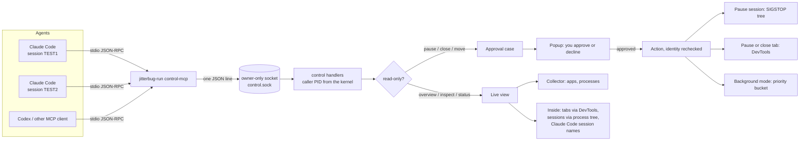
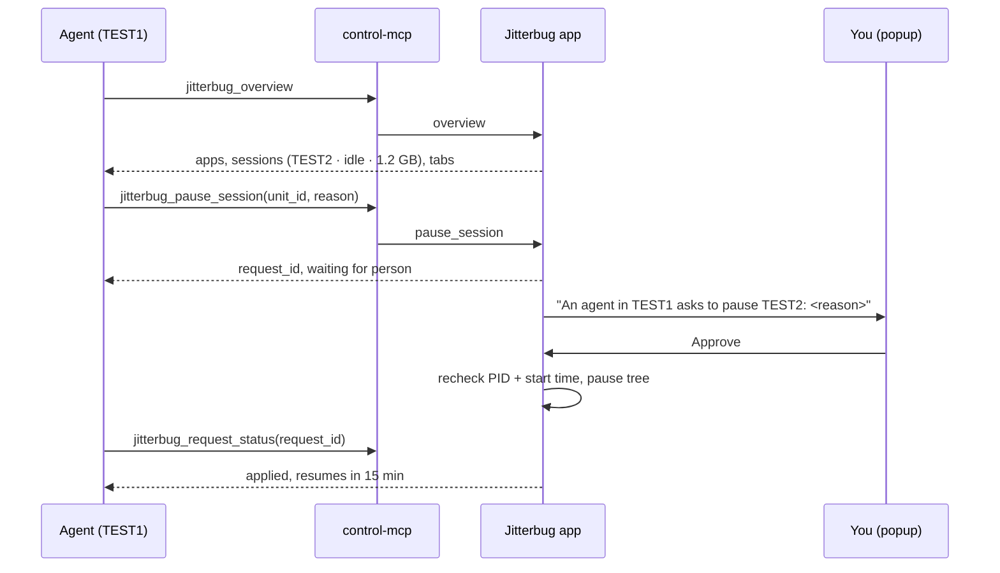
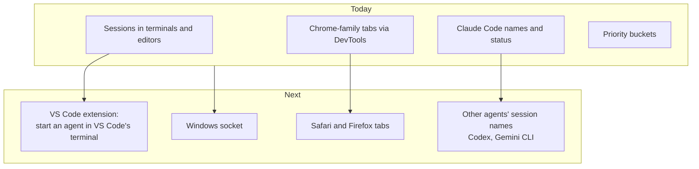

# MCP integrations

Jitterbug speaks to coding agents through two separate stdio MCP servers, both started from the
`jitterbug-run` binary. Neither makes model calls or keeps state; each tool call is one request to
the running desktop app.

| Server           | Command                     | For                                                        |
| ---------------- | --------------------------- | ---------------------------------------------------------- |
| Agent control    | `jitterbug-run control-mcp` | See what uses the machine; request pauses, closes, moves   |
| Validation queue | `jitterbug-run mcp …`       | Take turns running checks ([details](validation-queue.md)) |

This page covers agent control. Setup and privacy limits are in
[app and agent control](app-and-agent-control.md#let-agents-request-resource-actions).

## How a request flows



Every action is a request. The agent gets a `request_id`, you decide in Jitterbug's popup, and the
agent reads the outcome with `jitterbug_request_status`. Agent control is off until you turn it on.

## A pause, step by step



An agent can never pause the session it runs in (marked `is_your_session`), never resume a pause
you made, and never act on an app in the Protected bucket.

## Tools

| Tool                           | Kind    | Does                                                        |
| ------------------------------ | ------- | ----------------------------------------------------------- |
| `jitterbug_overview`           | read    | Machine pressure, busiest apps, sessions inside terminals   |
| `jitterbug_inspect_app`        | read    | One app's sessions, or a browser's tabs (one-second sample) |
| `jitterbug_request_status`     | read    | Whether a request waits, was applied, or was declined       |
| `jitterbug_pause_session`      | request | Freeze a command session and everything it started          |
| `jitterbug_resume_session`     | request | Resume a session the agent paused                           |
| `jitterbug_pause_tab`          | request | Freeze one browser tab without closing it                   |
| `jitterbug_resume_tab`         | request | Resume a tab the agent paused                               |
| `jitterbug_close_tab`          | request | Close one tab; always asks                                  |
| `jitterbug_request_background` | request | Move an app to the Background priority bucket               |

Pauses lift after 15 minutes. A paused tab also wakes if Jitterbug quits, because the freeze lasts
only while Jitterbug holds the tab's DevTools session.

## Warn agents before heavy work

Agents call MCP tools only when they think to, and a slow build rarely makes them think of
Jitterbug. The `pressure-hint` hook brings it up at the right moment instead. Print its settings
and merge them into `~/.claude/settings.json` (Settings › Integrations shows the same JSON):

```sh
src-tauri/target/debug/jitterbug-run hint-settings
```

Before each shell command, the hook checks whether the command is heavy (builds, test suites,
installs, containers, local models). Quick commands return without contacting the app. For a
heavy one it asks the app with `pressure_hint`. When the machine is at `watch` or `high`, the agent
gets one note in its context naming the other sessions using most of what is strained (CPU,
memory, or both; sessions using under 5% CPU or 512 MiB are left out), for example:

> Jitterbug: this computer is under sustained pressure (CPU 88%, 1.1 GB memory free). Other
> sessions using the most: TEST2 (idle, 1.4 GB, 0% CPU, unit_id session:42-7). Before this
> command, say so in one line, then wait, run a narrower command, or … ask to pause the least
> urgent idle one with jitterbug_pause_session.

The hook never blocks or changes a command. It stays silent when the app is closed, agent access
is off (and doesn't ask for access), or the machine is fine. Each session gets a note at most once
every three minutes unless pressure gets worse. Codex shell events are read too, if your Codex
hooks run the same command.

## See what agents asked

Monitor's **AI activity** strip lists model calls and, under **Agents**, every request agents sent
this app session: the tool, the agent and session that asked, and the outcome. Pressure checks
show as "Warned before heavy work" or "Checked before heavy work". Only metadata is kept, in memory
(the last 100), with no arguments, reasons or answers.

## How it expands



A new capability is added in one place per layer: a tool in `control/mcp.rs`, its handler in
`control/handlers.rs`, the data in `inside/`, and, for actions, an approval option in
`inside/options.rs` that the popup already knows how to show.

## Testing it

1. **Unit tests.** `cargo test --manifest-path src-tauri/Cargo.toml --lib control` covers tool
   listing, argument checks, ownership, and limits.
2. **Lab console.** Debug builds open the Jitterbug Lab. Its Agent (MCP) column sends real JSON-RPC
   through the same socket as an agent, shows each request and answer, and turns returned units
   into one-click pause or close requests whose approvals appear in the Live popup.
3. **A real agent.** Register the server with Claude Code, then ask a session to use it:

    ```sh
    cargo build --manifest-path src-tauri/Cargo.toml --bin jitterbug-run
    claude mcp add jitterbug-control -- "$PWD/src-tauri/target/debug/jitterbug-run" control-mcp
    ```

    With two named sessions open, ask one: "Use jitterbug to list my sessions and pause the idle
    one." The approval appears in Jitterbug's popup.

4. **By hand.** Pipe JSON-RPC into the server while the app runs:

    ```sh
    printf '%s\n' '{"jsonrpc":"2.0","id":1,"method":"tools/list"}' \
      '{"jsonrpc":"2.0","id":2,"method":"tools/call","params":{"name":"jitterbug_overview","arguments":{}}}' \
      | src-tauri/target/debug/jitterbug-run control-mcp
    ```
