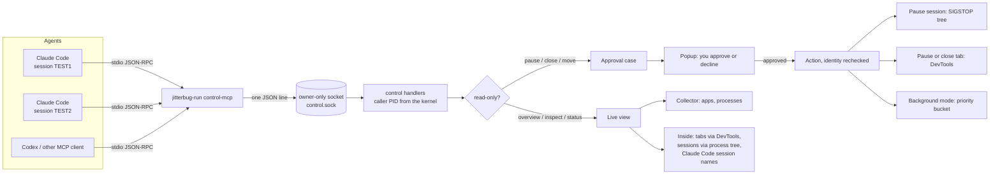
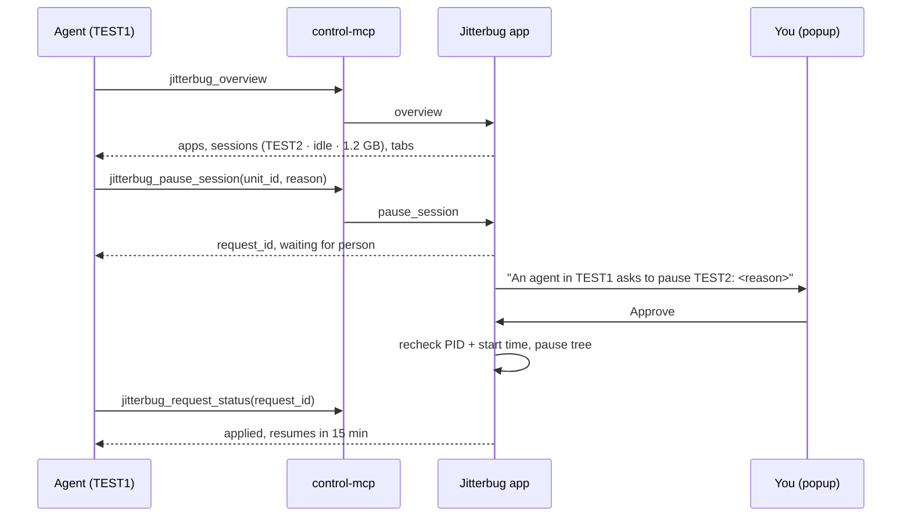
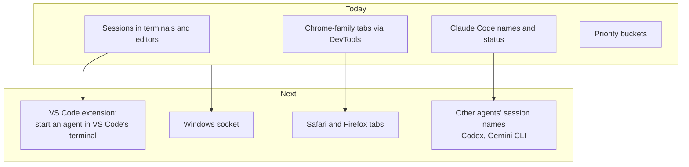

# MCP integrations

Jitterbug speaks to coding agents through two separate stdio MCP servers, both started from the
`jitterbug-run` binary. Neither makes model calls or keeps state; each tool call is one request to
the running desktop app.

| Server           | Command                     | For                                                        |
| ---------------- | --------------------------- | ---------------------------------------------------------- |
| Agent control    | `jitterbug-run control-mcp` | See what uses the machine; request pauses, closes, moves   |
| Validation queue | `jitterbug-run mcp …`       | Take turns running checks ([details](validation-queue.md)) |

This page covers agent control. Setup and privacy limits are in
[app and agent control](app-and-agent-control.md#let-agents-request-resource-actions).

## How a request flows



Every action is a request. The agent gets a `request_id`, you decide in Jitterbug's popup, and the
agent reads the outcome with `jitterbug_request_status`. Agent control is off until you turn it on.

## A pause, step by step



An agent can never pause the session it runs in (marked `is_your_session`), never resume a pause
you made, and never act on an app in the Protected bucket.

## Tools

| Tool                           | Kind    | Does                                                        |
| ------------------------------ | ------- | ----------------------------------------------------------- |
| `jitterbug_overview`           | read    | Machine pressure, busiest apps, sessions inside terminals   |
| `jitterbug_inspect_app`        | read    | One app's sessions, or a browser's tabs (one-second sample) |
| `jitterbug_request_status`     | read    | Whether a request waits, was applied, or was declined       |
| `jitterbug_pause_session`      | request | Freeze a command session and everything it started          |
| `jitterbug_resume_session`     | request | Resume a session the agent paused                           |
| `jitterbug_pause_tab`          | request | Freeze one browser tab without closing it                   |
| `jitterbug_resume_tab`         | request | Resume a tab the agent paused                               |
| `jitterbug_close_tab`          | request | Close one tab; always asks                                  |
| `jitterbug_request_background` | request | Move an app to the Background priority bucket               |

Pauses lift after 15 minutes. A paused tab also wakes if Jitterbug quits, because the freeze lasts
only while Jitterbug holds the tab's DevTools session.

## How it expands



A new capability is added in one place per layer: a tool in `control/mcp.rs`, its handler in
`control/handlers.rs`, the data in `inside/`, and, for actions, an approval option in
`inside/options.rs` that the popup already knows how to show.

## Testing it

1. **Unit tests.** `cargo test --manifest-path src-tauri/Cargo.toml --lib control` covers tool
   listing, argument checks, ownership, and limits.
2. **Lab console.** Debug builds open the Jitterbug Lab. Its Agent (MCP) column sends real JSON-RPC
   through the same socket as an agent, shows each request and answer, and turns returned units
   into one-click pause or close requests whose approvals appear in the Live popup.
3. **A real agent.** Register the server with Claude Code, then ask a session to use it:

    ```sh
    cargo build --manifest-path src-tauri/Cargo.toml --bin jitterbug-run
    claude mcp add jitterbug-control -- "$PWD/src-tauri/target/debug/jitterbug-run" control-mcp
    ```

    With two named sessions open, ask one: "Use jitterbug to list my sessions and pause the idle
    one." The approval appears in Jitterbug's popup.

4. **By hand.** Pipe JSON-RPC into the server while the app runs:

    ```sh
    printf '%s\n' '{"jsonrpc":"2.0","id":1,"method":"tools/list"}' \
      '{"jsonrpc":"2.0","id":2,"method":"tools/call","params":{"name":"jitterbug_overview","arguments":{}}}' \
      | src-tauri/target/debug/jitterbug-run control-mcp
    ```
